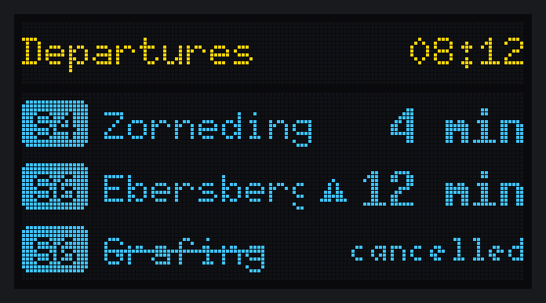

# ESP32 Departures

A tiny departure board for the Munich S-Bahn: it shows the next three trains from
**Donnersbergerbrücke** that stop at **Vaterstetten**, with live delays and cancellations.



The minutes are the real departure time, delays included. A ⚠ means the train is late;
cancelled trains are crossed out.

## Hardware

- ESP32-C3 Super Mini
- 0.96" I2C OLED, 128×64, SSD1306 (yellow/blue two-colour version)

| OLED | ESP32-C3 |
|------|----------|
| GND  | G        |
| VCC  | 3.3      |
| SCL  | GPIO1    |
| SDA  | GPIO0    |

## Setup

1. Install [arduino-cli](https://arduino.github.io/arduino-cli/), the `esp32` core and the `U8g2` and `ArduinoJson` libraries.
2. Copy `firmware/secrets.example.h` to `firmware/secrets.h` and fill in your WiFi
   (a second, optional network is tried if the first isn't reachable).
3. Build and flash:

   ```sh
   cd firmware
   arduino-cli compile --fqbn esp32:esp32:nologo_esp32c3_super_mini .
   arduino-cli upload  --fqbn esp32:esp32:nologo_esp32c3_super_mini -p /dev/cu.usbmodem* .
   ```

## How it works

Every 30 seconds the board asks the [MVG](https://www.mvg.de) departures API for the
station's S-Bahn departures and keeps the trains heading to a stop at or beyond
Vaterstetten (Zorneding, Grafing, Ebersberg, …). Some eastbound S4s end at Trudering,
so filtering by line alone isn't enough.

The station, the destinations and the number of trains are set at the top of
[`firmware/firmware.ino`](firmware/firmware.ino). Set `DEMO_MODE` to `true` to preview
the layout with sample trains.

Inspired by [mvv-display-for-ESP32](https://github.com/florianlederer/mvv-display-for-ESP32).
